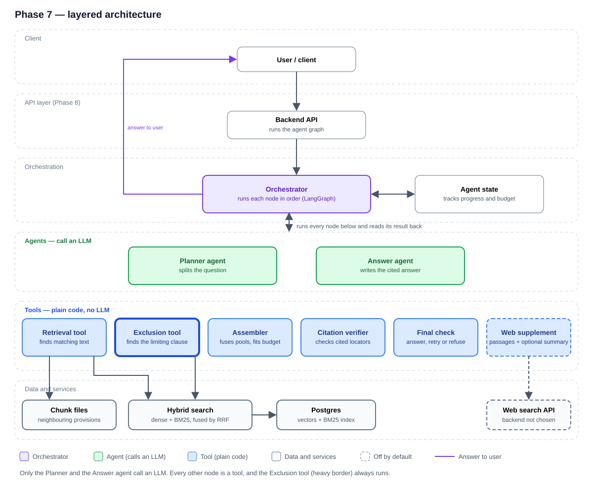
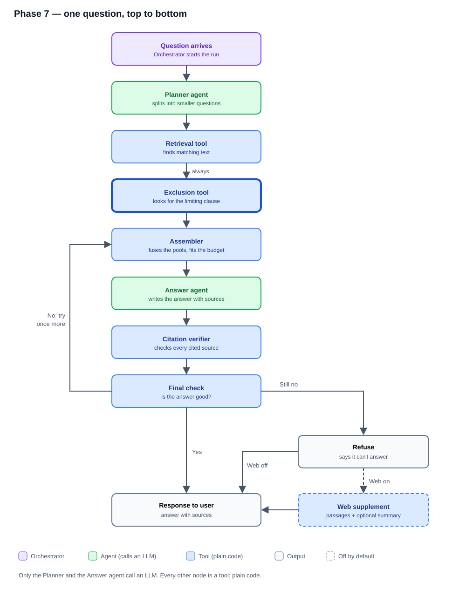
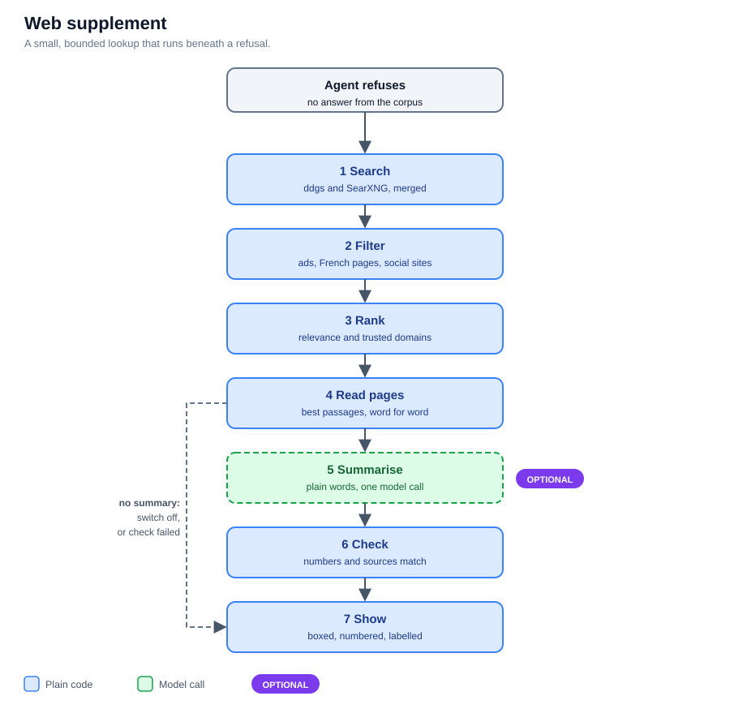
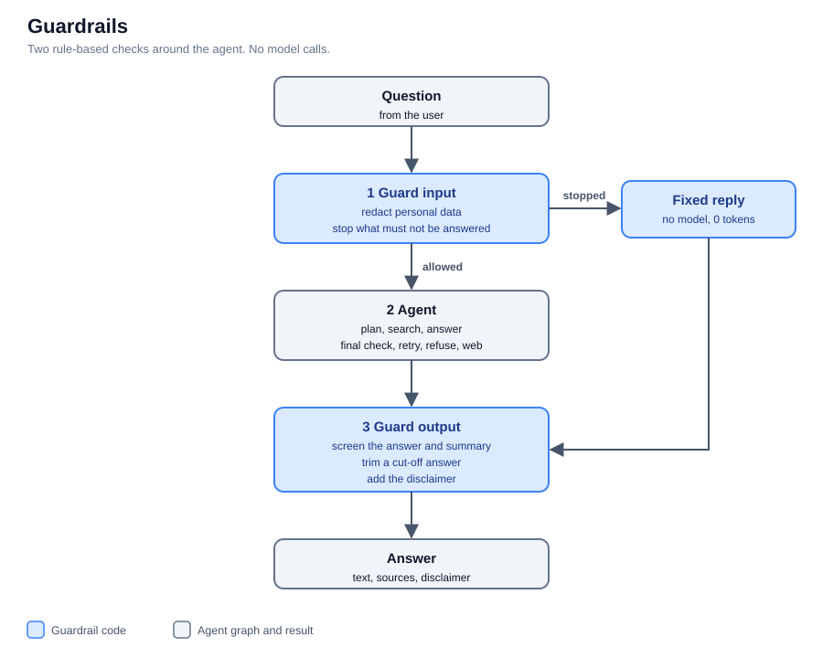

# Agent architecture — Phase 7

The build design for the LangGraph agent and the web fallback tier. Decisions and their
reasoning live in `docs/plan.md`; iteration 1's build record is `docs/RAG_pipleline.md`.
**Built and measured; see [Results so far](#results-so-far).** The design is organised by layer, in the order a question moves
through them. Only two layers are agents (they call an LLM); the rest are tools (plain code) or
the graph that runs them.

---

## Why, in numbers

Multi-hop recall is **0.182** (4 of 22) at k=5. The ceiling at top-20 is **0.409** (9 of 22), and **13 of 22
multi-hop questions have gold clauses outside the top 20 entirely** — one query cannot surface
them at any depth, however it is ranked. Chunk size did not move this (Phase 3), a lexical
channel did not (Phase 4), two cross-encoders did not (Phase 5, rejected). The one variable
never changed is the *shape*: one question, one embedding, one pool.

The agent changes what gets asked. It is the only remaining mechanism that can pass 0.409.

Exclusion recall is 0.500 at k=5 and **0.731 at k=20** — so 0.731 is what the mandatory
exclusion pass has to beat, not 0.500.

---

## The architecture

<p align="center">
  
</p>

Who talks to whom. Purple is the orchestrator, green **agents** call an LLM, blue **tools** are
plain code, white boxes are data and services, dashed is off by default. The client and API
layers are Phase 8.

<p align="center">
  
</p>

One question, top to bottom. The only branches are the retry and the web tier. The
[guardrails](#guardrails) wrap this flow: one check before it, one after.

### Why a fixed graph and not a ReAct agent

A tool-calling agent chooses its next action. The spec's central decision forbids exactly that:
*"if the model can decide to skip the exclusion check, it eventually will."* So this is a
**workflow with one bounded retry**, not an autonomous agent — almost every edge is
unconditional, and that is the design rather than a limitation of it. The Orchestrator in the
diagrams is this graph, not a model: no model chooses which node runs next.

### Layer map

**Agent** = calls an LLM. **Tool** = deterministic code, no model. **Graph** = the orchestrator.
Two agents, seven tools; the web tool can make one optional summary call.

| layer | type | graph node | code | calls | model |
|---|---|---|---|---|---|
| Orchestrator | Graph | the graph | `graph.py`, `run_agent` | — | none |
| Agent state | State | — | `state.py`, `AgentState` | — | — |
| Planner | **Agent** | `plan` | `decompose.py`, `decompose()` | — | Gemini flash-lite, cached |
| Retrieval | Tool | `gather` | `search_corpus` per sub-question + `tools.expand` | hybrid search, chunk files | none |
| Exclusion | Tool | `exclusion_check` | `tools.exclusion_pass` | hybrid search | none |
| Assembler | Tool | `assemble` | `search.fuse` + `within_budget` | — | none |
| Answer | **Agent** | `synthesize` | `SYSTEM` (+ plain-language rule when guarded), `_chain()` | — | Groq `gpt-oss-120b` |
| Citation verifier | Tool | inside `synthesize` | `cited()`, records `cited_nothing` | — | none |
| Final check | Tool | retry edge | deterministic trigger in `graph.py` | — | none |
| Web supplement | Tool | `web_supplement` | `web.py`, `web_summary.py` | search backends, page fetch | none; optional Gemini summary, flag-gated |
| Guardrails | Tool | `guard_input`, `guard_output` | `policy.py`, `policy_rules.json` | — | none |

### Token budget

**One Groq call per question, two with the retry.** Decomposition is Gemini flash-lite and
cached: 62 fixed questions cost 62 calls once, **0 Groq**, and nothing on every later run.
`agent_token_budget` (185_000) is a process-wide total and raises `BudgetExceeded` before Groq's
200k daily cap. **Measured:** one real question cost 8.2k tokens over two calls (~4k per call at
`agent_context_tokens=3000`), so the full generation row is ~230–250k, not the ~135–150k first
estimated. It does not fit one Groq day at 3000.

### The graph

```
plan ─> gather ─> exclusion_check ─> assemble ─> synthesize ─┬─> END
Planner Retrieval  Exclusion            ^        Answer +    ├─> refuse ─> END
                                        │        Verifier    │
                                        └──── retry (<=1) ───┘   Final check
```

The only conditional edges in the whole graph are the bounded retry, the web branch
(see [Web supplement](#web-supplement)) and the stop after `guard_input`. `guard_input` runs
first and `guard_output` last; every path ends in `guard_output` (see [Guardrails](#guardrails)).

---

## Kill-check (passed)

Before building, a free check asked whether a provision's own heading and first sentence, used as a
query, retrieves that provision at k=5 (a one-off probe over the 38 gold provisions of the 13 failing
multi-hop records, since removed and kept in git history). That is the ceiling on any decomposition strategy. The kill line was
0.68, where `p^2.5` equals the single-query ceiling. The result was **0.921 (35 of 38)**, so Phase 7
went ahead.

---

## The metric — settled before building

The comparator is the **widest single-shot row**, not the k=5 rows: it saw the same number of
chunks and cost nothing, and its `misses` list is exactly the 13 records. With the ladder now at
`ladder_top_k = 25`, that control must be re-measured as `pool_k25` before the agent has
anything honest to be compared against.

1. The agent returns its pools as **one RRF-fused union**, not a concatenation — reuse
   `search.fuse()` with pools as named channels (`main`, `sub:0`, `sub:1`, `exclusion`). `Hit.channels` then records which pass found each chunk, which is the spec's
   "state what was checked" for free.
2. **Budget-matched score:** truncate the union to the ladder width before scoring, through the
   existing `evaluators.DEPTH` mechanism. *If the agent cannot beat the single-shot multi-hop
   number at the same chunk count, it retrieved more rather than better, and the row is not
   worth publishing.*
3. **Honest-depth score:** `context_recall_single` / `context_recall_multi` /
   `context_exclusion_recall`, scored at `len(retrieved)` — what actually survived
   `within_budget` into the prompt. Fixed key names; the varying `n` goes in provenance.
4. **`context_chunks` and `context_tokens` on every row.** Without them a long agent prompt
   gets compared to the baseline's measured 825 tokens and called a win — exactly how the
   uniform-512 arm was caught in Phase 3.

---

## The layers

All code lives under `insurance_rag/agent/`. Each section opens with its **Type**: Agent (calls an
LLM), Tool (plain code) or Graph.

### Orchestrator and agent state

**Job:** run the graph above in order, enforce the step cap and the token budget.
**Type:** Graph — no LLM. **Files:** `graph.py`, `state.py`, `budget.py`.

```python
class AgentState(TypedDict):
    question: str; sub_questions: list[str]; pools: dict[str, list[Chunk]]
    checked: list[str]; context: list[Chunk]; answer: str
    retries: int; steps: int; tokens: int; web: list[WebResult]; web_summary: str

@dataclass(frozen=True)
class AgentAnswer:
    question: str; text: str; chunks: list[Chunk]; retrieved: list[Chunk]
    checked: list[str]; steps: int; tokens: int
    cited_nothing: bool          # feeds the Final check
    web: list[WebResult] = []    # rendered beneath a refusal, never in the prompt
    web_summary: str = ""        # optional, shown above the web sources

def run_agent(question: str) -> AgentAnswer
class BudgetExceeded(RuntimeError): ...
```

`max_agent_steps` (10) caps the run: retry, refuse and the web tier is the longest path.
`agent_token_budget` counts Groq tokens only; the Gemini planner and web-summary calls are outside it.
**Reuse, do not fork:** `format_context`, `within_budget`, `cited`, `REFUSAL`, `revoked_docs`, the
`SYSTEM` prompt unchanged, `with_retry`, `fuse`. **`chain.answer()` stays untouched** so every
recorded row remains reproducible.

**Tested by:** step cap, retry cap and budget tests in [Tests and eval safety](#tests-and-eval-safety).

### Planner agent

**Job:** split the question into at most 3 sub-questions.
**Type:** Agent. **Model:** `gemini/models/gemini-3.1-flash-lite`, cached. **File:** `decompose.py`.

```python
DECOMPOSE_SYSTEM: str
def decompose(question: str, *, cache: Path = CACHE) -> list[str]   # <= 3
def build_cache(questions: list[str], path: Path) -> int
```

Runs through the existing `providers.chat_model`, and is **cached to
`data/decompositions.jsonl`** keyed by question hash. 62 fixed questions: 62 Gemini calls
once, **0 Groq**, free on every later run. The cache doubles as the inspection artefact.

The cap of 3 comes from the failing records: mean independent provisions per failing record is
2.5.

**If the model is down** (a Gemini 503): it tries `gemini-3.5-flash-lite` straight away, with no
waiting. If both fail it returns no sub-questions, so the question is searched alone, and nothing
is cached.

**Tested by:** a graph test that sub-questions become pools, the fallback and both-down paths,
and the 22 multi-hop decompositions read by eye.

### Retrieval tool

**Job:** run `search_corpus` on the original question (channel `main`) and on each sub-question
(channels `sub:0`, `sub:1`, …).
**Type:** Tool — no LLM. **File:** `graph.py` (the `gather` node).

Ordinal neighbours (the chunks just before and after each hit) were built and measured, then
removed: they added nothing on single or multi-hop and cost two exclusion records.

**Tested by:** the retrieval rows in [Results so far](#results-so-far).

### Exclusion tool

**Job:** find the clause that limits or cancels what the other passes found. It runs on every
question — `exclusion_check` is on an **unconditional** edge.
**Type:** Tool — no LLM. **File:** `tools.py`.

```python
LIMITING_CUES: tuple[str, ...]
def exclusion_probe(question: str) -> str              # template reformulation, no LLM
def cue_score(chunk: Chunk) -> int
def exclusion_pass(question: str, *, k: int = 10) -> list[Hit]
```

**The exclusion pass fuses three channels:** a template probe query unfiltered, the plain
question at `role_filter=[EXCLUSION, CONDITION]` on low weight, and cue-based promotion (gold
exclusion chunks carry limiting language — *"shall not"*, *"unless"*, *"subject to"*, *"does not
apply"*, *"except"*, *"not entitled"* — at **0.73 against a 0.245 corpus base rate**).

The number to beat is **0.731** exclusion recall — single-shot at k=20, not 0.500 at k=5.

**Tested by:** `"exclusion" in checked` for all 62 records, and the exclusion-pass checkpoint.

### Assembler

**Job:** fuse every pool into one ranked context that fits the budget.
**Type:** Tool — no LLM.

Pools are fused as one RRF union with named channels, as settled in
[The metric](#the-metric--settled-before-building), item 1. The result is cut to
`agent_context_tokens` (3000) through `within_budget`.

**The exclusion tool's top 2 hits enter the context unconditionally**, regardless of fused
rank. Without a reserved floor, RRF can outvote the mandatory check and the edge becomes
decorative — the spec's own failure mode relocated from the prompt into the ranker.

**Tested by:** the budget-matched and honest-depth scores in the metric.

### Answer agent

**Job:** write the answer from the assembled excerpts, citing a locator after every statement, or
reply with exactly `REFUSAL`.
**Type:** Agent. **Model:** Groq `gpt-oss-120b` — the only Groq call in the graph.

Reuses the `SYSTEM` prompt from `chain.py` plus one appended rule, and `with_retry` for rate
limits. The appended rule's wording is not yet written.

**Tested by:** refusal reachable and returning exactly `REFUSAL` with zero citations.

### Citation verifier

**Job:** find which excerpts the answer actually cites.
**Type:** Tool — no LLM.

Reuses `cited()` from `chain.py`, which matches whole locators after NFKC normalisation, so
`s. 1` never matches inside `s. 18` or `s. 1(2)`.

**The trap:** `chain.py` returns `cited(text, retrieved) or retrieved`, so `Answer.chunks` is
*never* empty for a non-refusal answer — it silently falls back to the whole retrieved set.
`not result.chunks` therefore detects refusals only, and "cited nothing" is invisible.

**Fix:** `AgentAnswer.cited_nothing`, recorded at synthesis **before** the fallback is applied.
Measured frequency after the `U+202F` fix: **2 of 62** answers genuinely cite nothing. The flag
feeds the Final check.

### Final check

**Job:** decide between answer, retry and refusal.
**Type:** Tool — no LLM, and never a second LLM call.

The retry trigger is **deterministic**: refusal string present, zero cited locators, or the
exclusion channel contributed nothing. At most one retry, back to the Assembler.

After the retry:

- Answer cites at least one locator → return it, even if the exclusion channel still found
  nothing. `checked` records that the pass ran and came back empty — the output states what was
  checked, not only what was found.
- Refusal string, or zero cited locators → **refuse** with exactly `REFUSAL`.

An answer that cites nothing becomes a refusal because the citation contract in `plan.md` has
no state for it: an answered state requires a clause locator. That costs the 2 of 62 uncited
answers, which were never renderable as answers under the contract anyway.

**What the retry changes:** the Assembler re-runs on the same pools at the full 6000-token
`MAX_CONTEXT_TOKENS` instead of `agent_context_tokens`. No new retrieval, one more Groq call.
`plan.md` still calls it a "reformulation retry"; that wording is stale.

**Tested by:** `retries <= 1`, and a test that an uncited answer after the retry returns exactly
`REFUSAL`.

### Web supplement

**Job:** show relevant public web passages, and optionally a plain-language summary, beneath a
refusal. Off by default, and off in every eval run.
**Type:** Tool, with one optional model call (Gemini, flag `web_summary`).
**Files:** `web.py`, `web_summary.py`.

**In plain words.** When the agent has to say "this corpus does not address that" and the web
switch is on, it does one small, bounded web lookup so the reader still gets something useful. It
finds Ontario auto-insurance pages, reads the most relevant ones, and shows the matching passages
word for word, with an optional plain-language summary on top. Everything is boxed, numbered and
labelled as unverified, and it never touches the answer, the citations or the evals.

The spec never mentions web search (zero occurrences across all 11 pages). The tier is Deviation 7's
invention, which is why it stays outside the measured path.

<p align="center">
  
</p>

#### Step by step

1. **Search.** Two engines feed one list: `ddgs` (DuckDuckGo, asked for Canadian English)
   and a local SearXNG. Each returns 10 results. "Ontario auto insurance" is added to the query when
   the question lacks it.
2. **Filter.** Drops ads, French pages (by word list and `/fr/` URLs), social and
   user-generated sites such as Reddit, Facebook and Quora, and duplicate URLs.
3. **Rank.** A result must contain at least 30% of the question's key words plus "Ontario".
   Official sites and regulators (`ontario.ca`, `fsrao.ca`, `ibc.ca`) move up; insurer and broker
   sales pages are dropped (a guardrail rule).
4. **Read pages.** The top 3 pages are downloaded (`robots.txt` respected, generic
   user-agent, 10 s and 1 MB limits). Menus and scripts are stripped, and up to 3 English paragraphs
   per page that mention Ontario are kept word for word. An unreadable page keeps its search snippet.
5. **Summarise** *(optional).* One Gemini call over those passages only. It must use plain
   words, keep every number, date, condition and exception, add nothing, and end each sentence with
   its source number such as `[1]`. Switch: `IRAG_WEB_SUMMARY`, off by default.
6. **Check.** The summary is rejected if it contains a number the sources lack, a sentence
   with no source marker, or a source number that does not exist.
7. **Show.** A boxed block under the refusal: the summary (if kept) on top, then numbered
   sources with their passages, URL and retrieval date, labelled unverified, not exclusion-checked
   and not legal advice.

The dashed line in the diagram is the shortcut taken when the summary is off or rejected: the
passages are shown on their own.

#### What changed

| step | before (a stub, then a plain `ddgs` snippet list) | now |
|---|---|---|
| Search | `ddgs` only, 3 results, the raw question | `ddgs` and SearXNG merged, 10 each, "Ontario auto insurance" added when missing |
| Filter | none; an ad link and French text reached the user | ads, French pages, social sites and duplicate URLs dropped |
| Rank | whatever order the engine returned | term overlap with the question and "Ontario" at 0.3 or more, official sites nudged up, sales pages dropped |
| Read pages | none, 2 to 3 line snippets only | top 3 pages fetched (robots.txt respected), best 3 Ontario paragraphs each, word for word |
| Summary | ruled out: no model text over web content | optional Gemini summary, kept only if it passes a faithfulness check |
| Show | title, snippet and URL | summary, then numbered sources with passages, URL, date and labels |

#### Tech stack

- LangGraph
- DuckDuckGo search (`ddgs`)
- SearXNG (self-hosted metasearch)
- `httpx`
- BeautifulSoup4 and `lxml`
- Gemini 3.1 flash-lite
- `pytest`

#### What the contract already decides

> State 3 layers *on top of* state 2 — the refusal still fires and is still tested. This is the
> whole reason the web tier is safe to add: it cannot mask a refusal, because the refusal is
> what it renders beneath.

This rules out the obvious design. Web search **cannot be a fifth tool the agent calls** — a
tool-calling agent would answer from the web instead of refusing, and the 16-record refusal
slice is scored on Correctness. The metric would stop measuring what it claims.

#### Shape — one gated terminal branch

```
synthesize ─┬→ answered, cited ─────────────→ END
            └→ refuse ──┬───────────────────→ END
                        └→ web_supplement ──→ END
                             conditional on settings.enable_web_fallback
```

The trigger is the refusal alone. There is no confidence score to widen it with: the
cross-encoder meant to supply one was measured and rejected, and uncited answers already become
refusals at the Final check.

```python
def after_refuse(state: AgentState) -> str:          # graph.py: the edge after `refuse`
    """The web tier runs after a refusal and only when the flag is on."""
    return "web" if settings.enable_web_fallback else "end"
```

No model call. Same deterministic pattern as the retry trigger.

#### Interface

```python
@dataclass(frozen=True)
class WebResult:
    title: str
    url: str
    snippet: str        # VERBATIM from the search engine
    retrieved_at: str   # ISO date, per the contract's "URL + retrieval date"
    passages: tuple[str, ...] = ()   # VERBATIM paragraphs read from the page

def web_supplement(question: str, *, k: int = 3) -> list[WebResult]   # search, rank, fetch
def summarize(question: str, results: list[WebResult]) -> str          # web_summary.py, optional
```

#### If something fails

- `ddgs` fails or finds nothing: SearXNG's results are still used, and the other way round.
- A page answers 403, or its `robots.txt` refuses: the search snippet is shown instead.
- No result is relevant enough: no web block is shown at all.
- The summary fails its check, or the model errors: only the word-for-word passages are shown.

#### What it will never do

- **Answer in place of a refusal.** It runs only after a refusal and only with the switch on.
- **Reach the answer's prompt or the citations.** The summary call sees only web passages and
  `format_context` sees only corpus chunks, asserted by test.
- **Pass off model text as law.** Passages are word for word. The summary is one controlled exception
  to the first design's "verbatim only" rule (decided 2026-11-07): a separate call, restricted to the
  fetched passages, checked for invented numbers and uncited sentences, shown above the sources and
  labelled "unverified, not legal advice".
- **Break the refusal.** A backend, page or model failure is logged and swallowed.

#### Known limits

- Many sites answer 403 to automated fetches (`fsrao.ca`, `rates.ca` and others), so those fall back
  to the search snippet.
- Term overlap misses synonyms ("raise" against "affect"); it replaced encoder scoring for speed.
- Passages are sometimes introductory text rather than the answer; the summary helps with that.
- The summary check cannot catch a reworded claim that keeps the same numbers. Gemini latency varies
  from 1 s to over 50 s on the free tier.
- The language check is a word-list heuristic, not a language detector, and there is no JavaScript
  rendering.
- Advice-like wording copied into a passage ("you can shop around") still passes; the guardrails
  screen the summary, not the word-for-word passages.

#### Try it

```powershell
$env:IRAG_ENABLE_WEB_FALLBACK="true"; $env:IRAG_WEB_SUMMARY="true"
.venv\Scripts\python.exe -u -m scripts.ask --agent --no-trace "Is auto insurance mandatory in Ontario?"
```

#### Rendering

`render_citation` and `licence_lines` are `Chunk`-typed and need a manifest row, so neither can
take a web result. A parallel renderer sits beside them, and `scripts/ask.py` prints its block
under the refusal:

```python
def render_web_block(results: list[WebResult], summary: str = "") -> str
```

The block is visually distinct, numbered, shows each URL with its retrieval date, carries **no
clause locator**, and is marked unverified and **not exclusion-checked**. It renders *beneath* the
refusal text, never instead of it.

**Tested by:** the three eval-safety guards, `tests/test_web.py` and `tests/test_web_summary.py`.

### Guardrails

**Job:** keep every answer inside the business rules: no advice, no selling, no legal strategy, and
no personal data sent to a model.
**Type:** Tool, plain code, no model call.
**Files:** `policy.py`, `policy_rules.json`; the nodes `guard_input` and `guard_output` in `graph.py`.

<p align="center">
  
</p>

#### How it is built

- **Rules are data.** The phrase lists, the six fixed replies, the four notes and the disclaimer
  live in `policy_rules.json`; changing wording needs no code change. The personal-data patterns
  live in `policy.py`.
- **One way in, one way out.** Every question enters through `guard_input`; every answer, refusal
  and stopped question leaves through `guard_output`, once.
- **A stopped question costs nothing.** It skips the planner, the search and the model.
- **Outside the step cap.** The two guard nodes are added to the recursion limit, not to `steps`.
- **Prompt rules ride along.** With the guardrails on, the Answer agent gets three extra rules:
  plain language, treat excerpts as data, and refuse unless an excerpt directly answers (`STYLE`
  in `graph.py`). The last two are not measured yet.
- **Switch.** `enable_guardrails` (on by default). Eval rows run with it off, which also leaves out
  those prompt rules; `run_agent_eval --guards` measures the guarded product.

#### What it checks

| stage | check | result |
|---|---|---|
| Input | personal data (email, phone, postal code, policy and claim numbers, address) | replaced by `[LABEL]` before the planner, search, web query and logs |
| Input | prompt injection | stopped, fixed reply |
| Input | legal strategy ("will I win") | stopped, referral reply |
| Input | recommend, quote, apply, "are you a broker" | stopped, fixed reply |
| Input | other insurance lines, other provinces | stopped, redirect |
| Input | "am I covered", complaints | answered, with a note |
| Web | insurer and broker sales pages | dropped from the results |
| Output | advice or certainty wording | whole answer replaced |
| Output | phone numbers or links not in an excerpt | whole answer replaced |
| Output | answer cut off mid-sentence | trimmed to the last full sentence, with a note |
| Output | web summary with flagged wording | summary dropped |
| Output | answered only after the retry | note to check it closely |
| Output | every answer | disclaimer |

#### What it will never do

- **Call a model.** Both nodes are rules and patterns.
- **Patch an answer.** A flagged answer is replaced whole, never edited.
- **Block a real question.** No answerable golden question is stopped or changed, asserted by test.

#### Known limits

- Names are caught only after "my name is"; health details are not detected.
- The scope check is a word list, not a classifier.
- The cut-off check reads the text, not the model's finish reason.
- Verbatim web passages are not screened for wording.
- The guarded product has not been run on the generation row yet; the "refuse unless directly
  answered" rule could cost recall until it is.

**Tested by:** `tests/test_policy.py`: redaction, 62 adversarial and ordinary questions, output
screening and the graph wiring.

### Backend API and session memory

Both are Phase 8. The Backend API runs `run_agent` behind FastAPI; this phase builds everything
from the Orchestrator down. Session memory for multi-turn conversations also waits for Phase 8 —
every eval is single-turn, so the per-request Agent state is all this phase needs.

---

## New config keys

```python
agent_context_tokens:    int = 3000        # half of MAX_CONTEXT_TOKENS - budget-matched
agent_decompose:         bool = True       # false skips the Planner, for ablation rows
agent_max_sub_questions: int = 3           # mean independent provisions per failing record: 2.5
agent_token_budget:      int = 185_000     # process-wide; fail before Groq's 200k, not after
decompose_model:         str = "gemini/models/gemini-3.1-flash-lite"
searxng_url:             str = ""          # empty skips the SearXNG fallback
web_min_relevance:       float = 0.3       # share of the question's terms a web result must contain
web_summary:             bool = False      # optional plain-language summary of the web passages
web_summary_model:       str = "gemini/models/gemini-3.1-flash-lite"
enable_guardrails:       bool = True       # false for every eval row
```

`max_agent_steps` (10) and `enable_web_fallback` (False) also live in `config.py`.

---

## Tests and eval safety

`tests/test_agent.py`, `tests/test_web.py`, `tests/test_web_summary.py` and `tests/test_policy.py`,
synthesis mocked, 0 tokens.
`tests/test_agent_integration.py` (marker `slow`) runs the retrieval nodes over the real corpus.

| protects | test |
|---|---|
| Exclusion tool | `"exclusion" in checked` for all 62 records — this is what makes step 4 an edge rather than a claim |
| Answer agent | refusal reachable and returning exactly `REFUSAL` with zero citations |
| Final check | `retries <= 1`; an answer citing nothing after the retry returns exactly `REFUSAL` |
| Orchestrator | `steps <= max_agent_steps`; `BudgetExceeded` raising before Groq's cap |
| Web supplement, guard 1 | `run_eval` sets `settings.enable_web_fallback = False` before anything loads — the same prior art as `settings.chunking` and `evaluators.DEPTH` |
| Web supplement, guard 2 | the graph reaches `END` from `refuse` without touching `web_supplement` when the flag is off |
| Web supplement, guard 3 | no `WebResult` ever reaches `format_context` |
| Web summary | a number the sources lack, an uncited sentence or a model failure drops the summary and shows only the passages; the summary flag off never calls the model |
| Guardrails | a stopped question reaches no planner, search or model; a flagged answer is replaced and lists no sources; no answerable golden question is blocked; the longest path fits the step cap with both guards; the eval runner leaves them off |

Three guards, because the flag now gates graph behaviour.

---

## Spec 05 — faithful, adapted, dropped

| item | verdict |
|---|---|
| Step 4 a graph edge, not a prompt instruction | **faithful** — unconditional edge, asserted by a test on the trace |
| DECOMPOSE bounded; SYNTHESIZE citing every clause; one retry; step cap; refuse cleanly | **faithful** |
| Step 4's `role_filter="exclusion"` / `"condition"` | **adapted** — only **8 of 33** gold exclusion locators carry `chunk_role=exclusion`; 11 are `coverage`, 8 `schedule`, 5 `other`. The predicate becomes probe query + cue promotion, with the role filter as one low-weight channel. The spec's *intent* — a separate unskippable pass whose only job is to find the limit — is preserved exactly; only the retrieval predicate changes |
| Step 3's `role_filter="coverage"` | **adapted to unfiltered** — 29 of 88 gold are `coverage` and 31 are `other`, so filtering discards 67% of gold |
| Step 2 `resolve_definition` | **dropped** — 1 of 88 gold locators (1.1%), the same number that killed Phase 6, and dense already surfaces definitions at rank 1–2 |

---

**Not adopted:** a no-LLM scope gate that refuses out-of-scope questions before retrieval. It
would have to be measured against the 16 unanswerable records, and shown not to refuse any
answerable one, before it earns a node.

---

## Verification

1. `python -m evals.validate_golden` reports `all locators resolve`, 62 records.
2. `pytest tests` (fast, 0 tokens) and `pytest -m slow` (the 62-question exclusion test).
3. A retrieval row with `python -m evals.run_agent_eval --suite retrieval --config <name>` is free;
   compare it with `pool_k15` or `pool_k25` at the same chunk count.
4. A retrieval row is identical with the web switch on or off, because both runners force it off.
5. The generation row (`--suite generation`) costs about 230–250k Groq tokens at
   `agent_context_tokens=3000`, so it needs a paid plan or a split run (see
   [Token budget](#token-budget)).
6. Diff `misses` against the single-shot control record by record. The 13 names are known.

## Results so far

Rows are written by `python -m evals.run_agent_eval` to `evals/agent_results/`; single-shot
controls stay in `evals/results/`. Retrieval rows, 0 tokens, at about 15 chunks / 2,800 tokens:

| row | chunks | single | multi | exclusion |
|---|---|---|---|---|
| agent, no planner (neighbours on, since removed) | 15.0 | 0.792 | 0.273 | 0.692 |
| agent + planner (`agent_v1`) | 15.9 | 0.833 | 0.318 | 0.731 |
| single-shot `pool_k15` | 15.0 | 0.833 | 0.318 | 0.654 |
| single-shot `pool_k25` | 25.0 | 0.875 | 0.409 | 0.769 |

- Kill-check passed: 35 of 38 provisions retrieve from their own text at k=5 (0.921).
- Exclusion is the one clear gain: 19 of 26 against 17 for the same-size control.
- Multi-hop ties the control at 7 of 22. The union of all pools finds the same 7, so the
  3000-token cut loses nothing: the misses are retrieval misses. Deeper sub-question pools
  (10, 20) and a plain-words planner prompt did not help.
- Ordinal neighbours (±2) added nothing on single or multi-hop and cost 2 exclusion records, so
  they were removed.
- The generation row is not yet measured; see [Token budget](#token-budget).
- The golden set changed after the first rows were recorded: `g-056` became multi-hop (22
  scored, was 21), so the old 0.143 / 0.381 are now 0.182 / 0.409.

## The honest risk

One query with zero tokens already scores 0.409 multi-hop. The agent must beat that **at the
same chunk count** to justify the phase. If the generation row disappoints, the free retrieval
rows and per-node traces attribute it without paying for separate runs.
