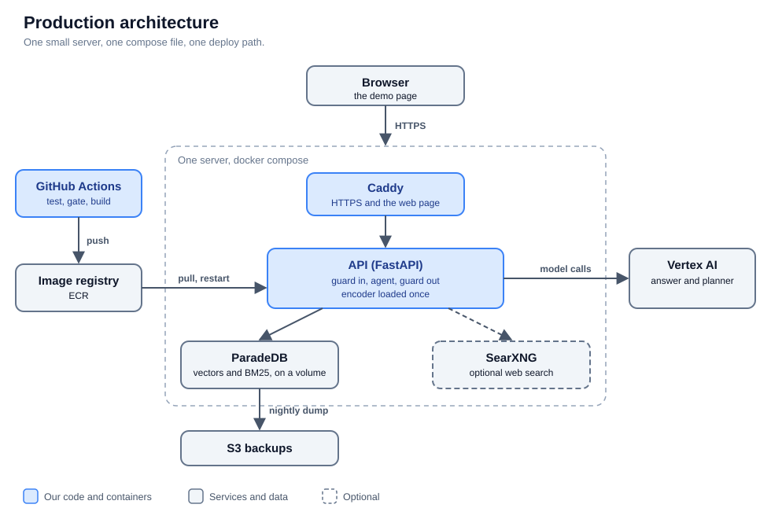

# Production plan — Phase 8

Basic on purpose: one small server, one `docker compose up`, one deploy path. Anything not
listed here is not needed for a public demo on free- and paid-tier models.

## What "production" means here

A public demo link for the portfolio, not paying customers. Single-turn questions, a handful of
users at a time. The scarce resource is the model quota, not CPU. The goals are: it stays up, it
cannot be abused into a large bill, every answer is traceable, and a regression is caught before
it ships.

  

## The pieces

| piece | what it is | built with | done when |
|---|---|---|---|
| API | `POST /ask` wraps `run_agent`; `GET /health` | FastAPI, uvicorn | `/ask` returns the answer, disclaimer, sources with passage text, web block and guard decisions |
| Demo page | one static page served by the API: question box, answer, sources, disclaimer, three demo questions, "don't enter personal or health details" | plain HTML | a stranger can use it with no instructions |
| Data | ParadeDB on a volume; index restored from a dump, not rebuilt | Docker volume, `pg_dump` | a fresh server answers its first question within minutes of `compose up` |
| Config and secrets | `.env` on the server, never in the image | `IRAG_*` settings | guardrails on, web on, evals untouched |
| Packaging | one image for the API, compose for API, database, optional SearXNG and Caddy | Docker, compose, Caddy | `docker compose up` works on a clean machine |
| CI | tests on every PR; a free retrieval gate on `main` | GitHub Actions | a recall drop fails the build |
| Deploy | build, push, pull and restart on merge to `main` | ECR, OIDC, SSH or SSM | a merge reaches the server with no manual step |
| Operations | one JSON log line per request, uptime check, nightly backup | log file, `pg_dump`, S3 | you can answer "what happened to this request?" |

## Details worth deciding now

**API limits.** Question at most 500 characters; about 10 requests a minute per IP, kept in
memory; `BudgetExceeded` becomes a 503 saying the daily limit is reached. The encoder loads once at
startup; the agent runs in a worker thread because it blocks. One worker is enough.

**CI gate, without secrets.** The plan's first idea was the LangSmith pytest integration, which
needs an API key a fork cannot see. The retrieval row needs no key, so gate on it instead:
- every PR: `ruff` and `pytest`, no database, a few seconds;
- on `main`: restore the database dump into a service container, run the retrieval row, fail if
  recall or exclusion recall falls below the committed baseline minus a small tolerance;
- before a release, by hand: the generation row (LLM-judged, needs keys and the paid plan).

Rebuilding the index in CI would embed 3,896 chunks on a CPU runner, which is slow (est.), so the
database dump is stored once and restored each time.

**Server size.** The encoder (Qwen3-Embedding-0.6B) plus Postgres plus the API probably needs
4 GB of memory (est.); the v2 spec's 2 GB `t4g.small` is likely too small. Measure the API's memory
with the encoder loaded before choosing. Expect roughly 25 to 30 dollars a month for a 4 GB
instance (est., check current prices).

**Backups.** The corpus can be rebuilt, but re-embedding is slow, so keep a nightly dump in S3 and
the `data/` folder (traces, planner cache) on the same volume.

## Gaps in the code to close first

- **The token budget is a process total.** `agent_token_budget` resets on every restart and never
  by the day. It needs a daily counter that survives a restart (a row in Postgres is enough).
- **No request-level timeout.** A slow web fetch or model call can hold a worker; add one around
  the whole `run_agent` call.
- **Trace retention.** Keep redacted trace lines 30 days (decided), then delete them.

## Order of work

Each step ships something on its own.

1. **API and demo page**, run locally. Done when `/ask` and the page work against the real agent.
2. **Docker and compose**, run locally from a clean checkout.
3. **CI**: tests on PRs, then the retrieval gate on `main`.
4. **Server and deploy**: create the instance, push the image, deploy on merge, add the `/health`
   check.
5. **Operations**: logs, uptime check, nightly backup, daily budget counter.
6. **`SECURITY.md` and a short demo video**, per the plan's definition of done.

## Decisions needed

1. **Cloud.** `docs/plan.md` leaves Azure against AWS open; the v2 spec chose AWS (a single EC2
   instance with compose, OIDC to ECR). Recommended: AWS, one VM.
2. **Web tier in production.** On, with SearXNG, or off at launch? `ddgs` is the flaky part. The
   web block already swallows failures, so on is safe; off is simpler.
3. **Public or invite-only.** Public needs the rate limit and the daily budget from day one.

## Deliberately left out

Accounts and login, session memory, Kubernetes, serverless, autoscaling, queues, a cache layer, a
CDN, multiple regions, blue-green deploys. Serverless in particular fits badly: the encoder is
over a gigabyte and would reload on every cold start, and the database still needs an always-on
host.
